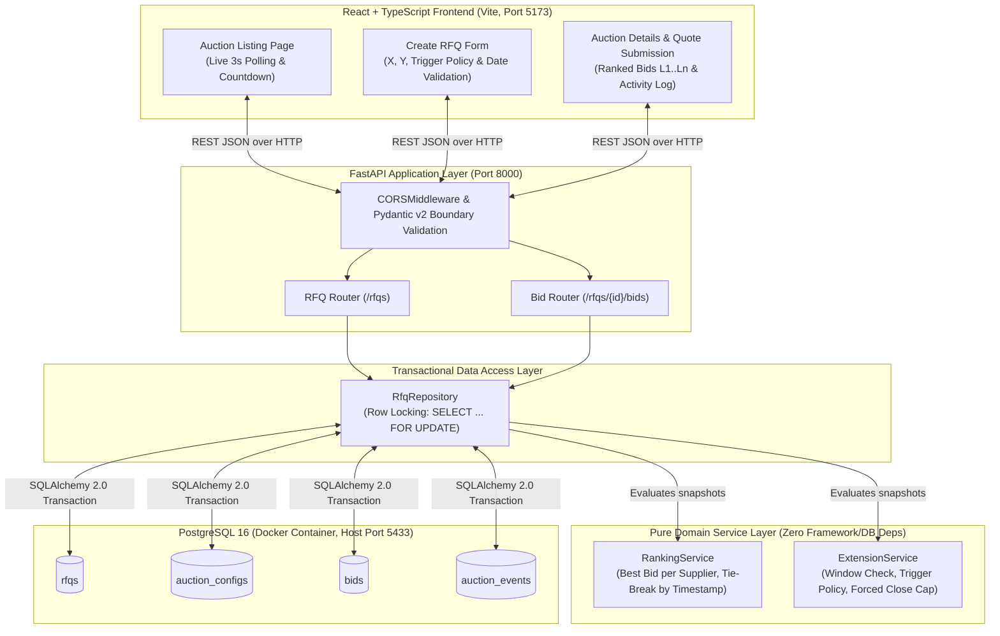
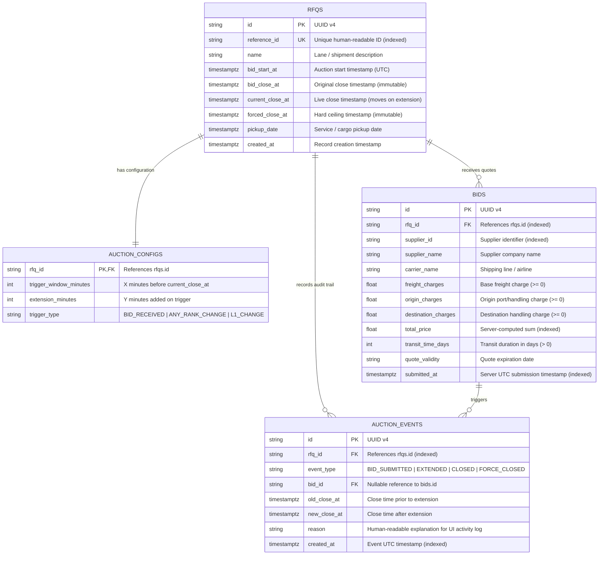

# High-Level Design (HLD) & Database Schema Design
## British Auction in RFQ System

---

## 1. System Overview & Architectural Goals

The **British Auction RFQ System** is an e-procurement freight negotiation platform where a buyer creates a Request for Quotation (RFQ) and competing suppliers submit open quotes to win the shipment. To eliminate last-second bid sniping and ensure transparent price discovery, the platform monitors bidding activity during a configurable **Trigger Window ($X$ minutes)** before the deadline and automatically extends the close time by **Extension Duration ($Y$ minutes)** whenever a configured trigger fires, strictly capped at an immutable **Forced Bid Close Time**.

### Core Architectural Principles
1. **Strict Separation of Concerns (Pure Domain Services):** All ranking (`RankingService`) and extension evaluation (`ExtensionService`) rules are pure Python functions operating on immutable value objects (`app/domain.py`). They have zero dependency on FastAPI or SQLAlchemy, enabling deterministic millisecond unit tests.
2. **Row-Level Pessimistic Locking (`SELECT ... FOR UPDATE`):** Concurrent bids arriving within milliseconds near the auction deadline are serialized at the database level on the parent `rfqs` row so two simultaneous transactions cannot evaluate stale rankings or double-extend the deadline.
3. **Server-Authoritative Clock & Total Price Calculation:** All timestamps are normalized to UTC on the server (`_as_utc`), and `total_price` is computed server-side (`freight_charges + origin_charges + destination_charges`) so client clock skew or payload tampering cannot corrupt rankings.
4. **Derived Auction Status on Read:** Auction status (`SCHEDULED`, `ACTIVE`, `CLOSED`, `FORCE_CLOSED`) is computed dynamically as a pure function of `(now, bid_start_at, current_close_at, forced_close_at)` so the UI never displays stale status between background cron ticks.

---

## 2. High-Level Architecture Diagram



---

## 3. Transactional Bid Submission & Anti-Sniping Flow

```mermaid
sequenceDiagram
    autonumber
    actor Supplier
    participant API as FastAPI Router
    participant Repo as RfqRepository
    participant DB as PostgreSQL
    participant Ext as ExtensionService / RankingService

    Supplier->>API: POST /rfqs/{rfq_id}/bids (Quote Charges)
    API->>Repo: submit_bid(db, rfq_id, payload)
    Repo->>DB: BEGIN TRANSACTION
    Repo->>DB: SELECT * FROM rfqs WHERE id = :rfq_id FOR UPDATE
    Note right of DB: Row lock acquired; concurrent bids block here
    Repo->>Repo: Validate bid_start_at <= now < current_close_at AND now < forced_close_at
    Repo->>Repo: Snapshot bids_before
    Repo->>DB: INSERT INTO bids (total_price = freight + origin + destination)
    Repo->>DB: INSERT INTO auction_events (BID_SUBMITTED)
    Repo->>Repo: Snapshot bids_after = bids_before + [new_bid]
    Repo->>Ext: evaluate(bids_before, bids_after, config, current_close_at, forced_close_at, now)
    Ext->>Ext: Check now >= current_close_at - X minutes
    Ext->>Ext: Compare rank_suppliers(bids_before) vs rank_suppliers(bids_after)
    Ext-->>Repo: ExtensionDecision(extended, new_close_at = min(current_close + Y, forced_close), reason)
    alt Decision.extended == True
        Repo->>DB: UPDATE rfqs SET current_close_at = :new_close_at
        Repo->>DB: INSERT INTO auction_events (EXTENDED, old_close_at, new_close_at, reason)
    end
    Repo->>DB: COMMIT (Releases row lock)
    Repo-->>API: Bid ORM Object
    API-->>Supplier: 201 Created (BidOut JSON)
```

---

## 4. Database Schema Design

### Entity-Relationship Diagram



### Table Definitions & Indexing Strategy

1. **`rfqs`**: Stores both `bid_close_at` (the initial baseline deadline) and `current_close_at` (the live deadline mutated by extensions) so the UI and analysts can always see whether and by how much an auction was extended without replaying events. Indexed uniquely on `reference_id`.
2. **`auction_configs`**: One-to-one table keyed by `rfq_id` storing the British Auction parameters ($X$, $Y$, and `trigger_type`).
3. **`bids`**: Stores every quote submitted by suppliers. Indexed on `rfq_id`, `supplier_id`, `total_price`, and `submitted_at` for fast ranking and detail page queries.
4. **`auction_events`**: Append-only audit log recording every `BID_SUBMITTED` and `EXTENDED` event along with `old_close_at`, `new_close_at`, and the exact human-readable trigger reason.

---

## 5. Key Business Rules & Edge Cases

* **Supplier Standing Definition:** A supplier's standing (`L1, L2, L3, ...`) is determined by their **lowest (best) bid submitted so far**. Ties in price are broken by whichever supplier reached that price **first** (`submitted_at` ascending). Consequently, a bid that merely ties an existing price does not unseat the incumbent and does not cause a rank change.
* **Inclusive Trigger Window Boundary:** A bid arriving at `now == current_close_at - X` is treated as **inside** the trigger window (`now >= window_start`).
* **Forced Close Capping:** Every extension calculates `new_close_at = min(current_close_at + Y, forced_close_at)`. If `current_close_at` has already reached `forced_close_at`, no further extension event is emitted.
